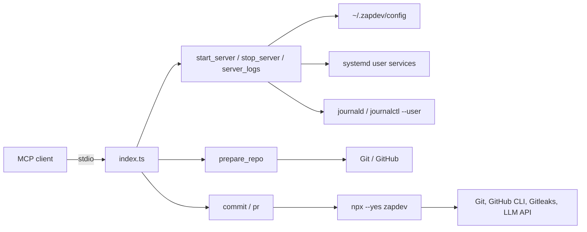

[](https://mvagnon.dev)
[](https://buymeacoffee.com/mvagnon)

# zapdev-mcp

> [!TIP]
> **Prefer the terminal?** Use **[zapdev](https://github.com/mvagnon/zapdev)**,
> the CLI powering this MCP server, for interactive commit and pull request workflows.

## Project Introduction

**zapdev-mcp** is a lightweight TypeScript MCP server that brings
[zapdev](https://github.com/mvagnon/zapdev) Git workflows to your AI assistant.

It prepares disposable GitHub checkouts, manages named development services and their logs,
generates Conventional Commits, and creates pull requests through six tools
exposed over stdio. Commit and PR
commands run through `npx --yes zapdev`; no global zapdev installation is needed.

## Project Architecture



- `index.ts`: MCP server, input validation, repository management, and CLI calls.
- `repositories.ts`: shared repository paths and input validation.
- `preparation.ts`: isolated repository and whole-group preparation.
- `config.ts`: shared repository and group configuration.
- `servers.ts`: server configuration, lifecycle commands, and startup context.
- `service-manager.ts`: isolated systemd user units and bounded log access.
- `index.test.ts` / `servers.test.ts`: repository, service lifecycle, commit, and PR checks.
- `dist/index.js`: compiled executable included in the npm package.

## Environment Variables

| Variable          | Required            | Description                                                                  |
| ----------------- | ------------------- | ---------------------------------------------------------------------------- |
| `ZD_URL`          | For `commit` / `pr` | Complete HTTP(S) Chat Completions endpoint, including its path               |
| `ZD_MODEL`        | For `commit` / `pr` | Model identifier supported by the endpoint                                   |
| `ZD_EFFORT`       | For `commit` / `pr` | Reasoning effort supported by your model, such as `low`, `medium`, or `high` |
| `ZD_API_KEY`      | No                  | Bearer API key; omit for endpoints without authentication                    |
| `ZD_HOOK_TIMEOUT` | No                  | Deadline per Git hook in seconds; zapdev defaults to `60`                    |
| `ZD_REPOS_DIR`    | No                  | Absolute checkout root directory; defaults to `~/.zapdev/repos`              |

The `ZD_REPOS_DIR` variable configures this server; the others configure zapdev.
The model must support reasoning effort
and strict JSON Schema Structured Outputs; OpenAI compatibility or JSON mode alone
is not sufficient. See [zapdev model configuration](https://github.com/mvagnon/zapdev#model-configuration)
for local and OpenRouter examples.

## Setup

### Requirements

- **Node.js >= 20 and npm:** run the server and invoke zapdev through `npx`.
- **Git:** clones repositories and performs Git operations.
- **Linux with a running systemd user manager:** required for starting and stopping
  configured services. Services run without sudo, independently of OpenCode's unit.
- **`journalctl` and a readable user journal:** required for service logs and failure
  diagnostics. `journalctl --user` requires persistent journal storage on the host.
  Journal access/configuration errors are reported; the MCP does not change host settings.
- **GitHub authentication:** configure non-interactive Git credentials for private
  repositories; install GitHub CLI and run `gh auth login` for `pr`.
- **LLM endpoint and model:** required for commit messages and PR titles.
- **Gitleaks (recommended):** zapdev scans staged changes when it is available on `PATH`.

### MCP Client Configuration

Once the package is published, add this server to a client supporting stdio MCP
servers. The following uses the common `mcpServers` format; adapt it to your client:

```json
{
  "mcpServers": {
    "zapdev": {
      "command": "npx",
      "args": ["--yes", "zapdev-mcp"],
      "env": {
        "ZD_URL": "http://localhost:1234/v1/chat/completions",
        "ZD_MODEL": "your-local-model-id",
        "ZD_EFFORT": "low"
      }
    }
  }
}
```

Use your endpoint's complete Chat Completions URL and a model supporting strict
structured outputs. Add `ZD_API_KEY` if authentication is required. Keep credentials
private and do not commit them to your repository.

The MCP client must make `git`, `npx`, and, for PRs, `gh` available on the server's
`PATH`. The server runs on the client's host, not in an isolated sandbox.

## Usage

### `prepare_repo`

Clone or refresh a GitHub repository in `~/.zapdev/repos/<owner>-<repo>`.

Set `ZD_REPOS_DIR` to an absolute path to override the root directory. For example,
`ZD_REPOS_DIR=/srv/repos` places `owner/repo` in `/srv/repos/owner-repo`.
An unset or empty value uses the default. Use a full path, not a literal `~`.

With `group: "my-group"`, the checkout is placed in
`<ZD_REPOS_DIR>/my-group/owner-repo`. Existing `<owner>/<repo>` checkouts are not
moved or deleted.

| Argument | Required | Description                                                         |
| -------- | -------- | ------------------------------------------------------------------- |
| `repo`   | Unless `group` is supplied | GitHub repository as `owner/repo`; without `group`, selects the root checkout |
| `group`  | Unless `repo` is supplied | Single group name; alone, refreshes all existing immediate child checkouts |
| `branch` | No       | Remote branch for each selected repo; defaults to each remote's default branch |

With `repo`, returns only the absolute checkout `path`. With `group` alone,
returns the group's `path` and `repositories: [{ path }]`. Only existing immediate
Git checkouts are refreshed; other directories, hidden directories, and symlinks
are ignored. GitHub origin URLs must match their checkout directory names.
No new repositories are discovered or cloned in group-only mode.
Use `start_server` to retrieve
`AGENTS.md` instructions and configured URLs. This replaces `get_repo`;
clients using the old tool name must switch to `prepare_repo`.

After Git preparation and secret linking, runs the optional `prepareCommand` from
`zapdev.json`. With `repo`, only that checkout's command runs, never its group's.
With `group` alone, each checkout is refreshed and runs its own command, then
group-root secrets are linked and the group's command runs once, even for an
empty group. Waits for each command (up to 180 seconds). Preparation stops at the
first failure; later repositories and the group command are not processed.
Command output is not included in
successful responses; command failures return an MCP error. Completed Git changes
and secret links are not rolled back. Without a command, nothing extra runs.

After each clone or refresh, matching secrets are symlinked from `~/.zapdev/secrets`:

| Source under `~/.zapdev/secrets/` | Destination under `ZD_REPOS_DIR`          |
| --------------------------------- | ----------------------------------------- |
| `my-group/config.json`            | `my-group/config.json`                    |
| `my-group/owner-repo/.env`        | `my-group/owner-repo/.env`                |
| `owner-repo/.env.local`           | `owner-repo/.env.local` (without `group`) |

Group-root files are linked only when preparing `group` alone, not `group + repo`.
Only files directly inside the group folder are linked into the group root.
With `repo`, that checkout's secrets include subdirectories; other repositories
are not linked. Grouped checkouts do not inherit secrets from outside their group.
Missing secrets folders are ignored. Existing regular files (including old copies)
are replaced with absolute symlinks; links to the expected source are preserved.
Source symlinks, unrelated destination symlinks, and Git metadata are rejected.
Source permissions are unchanged: protect sensitive source files with `0600`.
Changes to the source are immediately visible through the link, and editing
through the link modifies the source secret. Keep repository symlinks ignored by
Git to prevent accidental commits; this tool does not add ignore rules.

**Destructive:** checkouts are disposable. Refreshing force-checks out the remote
branch, overwrites tracked changes, and removes untracked files and directories
except ignored files. Never use this tool for a checkout containing work you
want to keep. Git authentication must work without interactive prompts.

### Repository configuration: `zapdev.json`

Store configuration under `~/.zapdev/config`, following the same group/repository
layout as secrets. These files are read directly, not copied or symlinked into
checkouts. `ZD_REPOS_DIR` changes checkout locations, not configuration locations.

| Configuration path                                 | Applies to                |
| -------------------------------------------------- | ------------------------- |
| `~/.zapdev/config/owner-repo/zapdev.json`          | Standalone repository     |
| `~/.zapdev/config/my-group/zapdev.json`            | Group (parent)            |
| `~/.zapdev/config/my-group/owner-repo/zapdev.json` | Repository inside a group |

Copy this template to the applicable location and adapt the commands and URLs:

```json
{
  "prepareCommand": "docker compose pull",
  "services": {
    "frontend": { "startCommand": "npm run dev" },
    "backend": {
      "startCommand": "docker compose up",
      "stopCommand": "docker compose down"
    }
  },
  "frontUrl": "http://localhost:3000",
  "apiUrl": "http://localhost:4000",
  "dbUrl": "postgresql://localhost:5432/app"
}
```

All five fields are optional; `{}` is valid. Missing files are treated as empty
configuration. Omitted commands do not run; omitted URLs are absent from context.
URLs must be valid absolute URLs, including database schemes. Malformed files,
unknown fields, and source symlinks are rejected.

| Field | Meaning |
| ----- | ------- |
| `prepareCommand` | Optional nonempty shell command executed by `prepare_repo` |
| `services` | Optional object of named services for this checkout or group; `{}` defines none |
| `services.<name>.startCommand` | Required nonempty shell command for that service |
| `services.<name>.stopCommand` | Optional nonempty shell command executed after the service's processes stop |
| `frontUrl`, `apiUrl`, `dbUrl` | Optional URLs returned in startup context |

Service names contain 1–63 ASCII letters, digits, `_`, or `-`, beginning with a
letter or digit. Names identify services in tool calls; unit IDs additionally
include a hash of the absolute checkout/group path to avoid collisions.

Commands execute through `/bin/sh` in the corresponding checkout or group directory
with the MCP server's environment. Only configure trusted commands: they run with
your host permissions. Systemd-specific invocation variables are not forwarded.
`stopCommand` is registered as `ExecStopPost`: systemd can also run it after a
startup or runtime failure. Cleanup must tolerate partially initialized or already
stopped services and be safe to repeat.
Run development servers in the foreground, without `&` or wrappers that hide a
nonzero exit code. Otherwise systemd supervises the wrapper rather than the server.

**Breaking change:** top-level `startCommand` arrays are no longer accepted.
Replace them with `services`. Startup responses now contain `services`, not
`commands` or PIDs. Configured service supervision requires Linux/systemd.

Commands and services are scoped to the selection; context keeps parent priority:

- `repo` alone targets only `<ZD_REPOS_DIR>/<owner>-<repo>`; it never searches groups.
- `group + repo` targets only that checkout's Git operations, secrets, prepare command,
  and services. Group commands and services never replace or augment its own.
- `group` alone includes the group's commands/services and all immediate child
  checkouts' commands/services. A group with `services: {}` does not disable children.
  The service-name filter applies across all selected paths, including duplicate names.
- **Behavior change:** callers relying on a single repository to manage shared group
  services or run the group's prepare command must now call with `group` alone.
  Service IDs remain unchanged; existing units remain selectable by their original paths.
- Each parent URL overrides the corresponding child URL. Other child URLs remain
  available. Grouped repositories do not inherit standalone configuration.
- Group `AGENTS.md` instructions take priority over repository instructions;
  both files are returned separately when starting a whole group.

### `start_server`

Start a prepared repository or group and return its context. Does not clone,
fetch, pull, switch branches, or reset repositories; call `prepare_repo` first
for the repository or whole group.

| Argument | Required                   | Description                                                      |
| -------- | -------------------------- | ---------------------------------------------------------------- |
| `repo`   | Unless `group` is supplied | GitHub repository as `owner/repo`                                |
| `group`  | Unless `repo` is supplied  | Alone: group services plus all child services; with `repo`: only that checkout |
| `service` | No                       | Configured service name; otherwise selects all services          |

Examples: `{"repo":"owner/repo"}`, `{"group":"my-group"}`, or
`{"repo":"owner/repo","group":"my-group"}`.

The `branch` argument is no longer accepted. Use `prepare_repo` to select an
existing remote branch, or `commit` to switch to or create a local branch.

Returns `path`, root `agents_md` when present, and configured `frontUrl`, `apiUrl`,
and `dbUrl`. A group also returns `repositories`, one entry per immediate child Git
checkout, with its path, root instructions, and effective URLs after parent
overrides. Other directories and symlinks are ignored. A single grouped repository
also includes a `parent` entry with the group's path, instructions, and URLs.

Each service runs in a separate transient systemd user unit. Already active units
are reused rather than duplicated, including across MCP/OpenCode restarts. A unit
in a failed state is reported as an error; stop it before starting again. Commands
and environment changes take effect on the next fresh start, not on reused units.
Units are not configured to restart automatically or survive a machine reboot.
Remaining logged in is normally required; enable user lingering separately if
services should continue after logout.

The response's `services` array contains `name`, `path`, stable unit `id`, systemd
`state`/`subState`, `result`, main-process `exitCode`, and `logSource` (`journal`, or
`file` for existing file-backed units). New starts are observed for about one second
to detect immediate failures. A failure includes the latest logs and preserves launch
diagnostics. `active`/`running` is a snapshot of process startup, **not server
readiness** or a guarantee against later crashes; verify the relevant URL. Use
`server_logs` to refresh the state and inspect later failures.
Successful commands that exit are retained as `active`/`exited`, so a later
`stop_server` can still run cleanup for externally managed services, such as
`docker compose up -d`. Such services need an appropriate `stopCommand`.

Partial successes remain in the response: an individual service can include
`error`, and the overall MCP response is marked as an error if any service fails.
No automatic port discovery or health checks are performed.

### `stop_server`

Accepts the same `repo`, `group`, and optional `service` as `start_server`.
First sends SIGINT (the signal used by Ctrl-C) to all processes in the unit and
waits up to 30 seconds for them to exit. Remaining processes are forcibly stopped
with SIGKILL before the optional `stopCommand` runs as cleanup. Cleanup has its
own 30-second timeout. Without `stopCommand`, the sequence ends after process
termination. Already stopped or absent units are left alone; unrelated systemd
services cannot be selected.

Existing units keep their original settings and log destination. After updating
the MCP, stop and start services once to recreate their units with journal logging;
that first stop still uses the old settings. Existing log files are not deleted.

Returns each service's final state/result, errors, and last 100 log lines. A failed
cleanup is reported even if the application has stopped. Makes no Git changes.

Example: `{"group":"my-group","service":"backend"}`.

### `server_logs`

Reads combined stdout/stderr and systemd diagnostics from the user journal.
Logs remain available after service stops and MCP restarts, subject to the host's
journal rotation, size limits, and retention policy. The MCP no longer creates or
appends files under `~/.zapdev/services`. Existing file-backed units remain readable,
alongside journal diagnostics; archived files are a fallback when the unit is gone
and no journal entries are available. No old files are removed automatically.

| Argument | Required | Description |
| -------- | -------- | ----------- |
| `repo` / `group` | At least one | Same repository/group scope as startup |
| `service` | No | Select a configured name; otherwise returns every selected service |
| `lines` | No | Last lines per service; defaults to 100, maximum 1000 |

Returns `services` with `name`, `path`, unit `id`, current systemd state/result,
`exitCode`, `logSource`, `logs`, and `truncated`. Failed services are marked as errors
while their logs remain included. Responses contain at most the last 64 KiB per
service, strip ANSI control sequences, and never stream to the MCP client.
An empty result means no entries were found; journal access errors are reported
separately, even when `journalctl` exits successfully with a warning.
Logs may contain application secrets; do not share them without review.

Example: `{"repo":"owner/repo","service":"frontend","lines":50}`.

### `commit`

Commit changes in a local Git repository using zapdev without interactive review.

| Argument | Required | Description                                                                    |
| -------- | -------- | ------------------------------------------------------------------------------ |
| `path`   | Yes      | Absolute path inside the local Git repository                                  |
| `branch` | No       | Local branch to switch to or create; defaults to the current branch             |
| `type`   | No       | Conventional Commit type; defaults to `auto`; append `!` for a breaking change |

Runs `zapdev commit --yes --pull --no-push`, adding `--branch=<branch>` when
supplied and `--type` when a non-automatic type is supplied. Without `branch`,
commits on the current branch. Pulls fast-forward updates when an upstream is
configured, commits changes, and never pushes.

Supported types: `auto`, `feat`, `fix`, `deps`, `chore`, `docs`, `style`, `refactor`,
`perf`, `test`, `build`, `ci`, `revert`. Explicit types can include `!`, such as `feat!`.

**Privacy:** commit context is sent to the configured LLM endpoint. Gitleaks
scanning is skipped when it is not installed.

### `pr`

Push the current branch and create a GitHub pull request without confirmation.

| Argument | Required | Description                                                                   |
| -------- | -------- | ----------------------------------------------------------------------------- |
| `path`   | Yes      | Absolute path inside the local Git repository                                 |
| `branch` | No       | PR target branch, not the working branch; defaults to GitHub's default branch |
| `closes` | No       | HTTP(S) task URL to append as `Closes <url>` in the description               |

Runs `zapdev pr --yes` with the supplied target branch and task reference.
Requires a clean working tree and authenticated GitHub CLI. Full branch commit
messages are sent to the configured LLM to generate the title; the description
is built from the commits.

**Safety:** never force-pushes. Do not retry blindly after an error: the branch
may already have been pushed or the PR created. Task closure depends on the
linked provider's integration.
