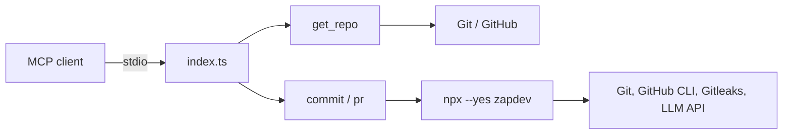

[](https://mvagnon.dev)
[](https://buymeacoffee.com/mvagnon)

# zapdev-mcp

> [!TIP]
> **Prefer the terminal?** Use **[zapdev](https://github.com/mvagnon/zapdev)**,
> the CLI powering this MCP server, for interactive commit and pull request workflows.

## Project Introduction

**zapdev-mcp** is a lightweight TypeScript MCP server that brings
[zapdev](https://github.com/mvagnon/zapdev) Git workflows to your AI assistant.

It prepares disposable GitHub checkouts, generates Conventional Commits, and
creates pull requests through three tools exposed over stdio. Commit and PR
commands run through `npx --yes zapdev`; no global zapdev installation is needed.

## Project Architecture



- `index.ts`: MCP server, input validation, repository management, and CLI calls.
- `index.test.ts`: commit and PR input validation and command invocation checks.
- `dist/index.js`: compiled executable included in the npm package.

## Environment Variables

| Variable          | Required            | Description                                                                  |
| ----------------- | ------------------- | ---------------------------------------------------------------------------- |
| `ZD_URL`          | For `commit` / `pr` | Complete HTTP(S) Chat Completions endpoint, including its path               |
| `ZD_MODEL`        | For `commit` / `pr` | Model identifier supported by the endpoint                                   |
| `ZD_EFFORT`       | For `commit` / `pr` | Reasoning effort supported by your model, such as `low`, `medium`, or `high` |
| `ZD_API_KEY`      | No                  | Bearer API key; omit for endpoints without authentication                    |
| `ZD_HOOK_TIMEOUT` | No                  | Deadline per Git hook in seconds; zapdev defaults to `60`                    |

These variables are inherited by zapdev. The model must support reasoning effort
and strict JSON Schema Structured Outputs; OpenAI compatibility or JSON mode alone
is not sufficient. See [zapdev model configuration](https://github.com/mvagnon/zapdev#model-configuration)
for local and OpenRouter examples.

## Setup

### Requirements

- **Node.js >= 20 and npm:** run the server and invoke zapdev through `npx`.
- **Git:** clones repositories and performs Git operations.
- **GitHub authentication:** configure non-interactive Git credentials for private
  repositories; install GitHub CLI and run `gh auth login` for `pr`.
- **LLM endpoint and model:** required for commit messages and PR titles.
- **Gitleaks (recommended):** zapdev scans staged changes when it is available on `PATH`.

### MCP Client Configuration

Once the package is published, add this server to a client supporting stdio MCP
servers. The following uses the common `mcpServers` format; adapt it to your client:

```json
{
  "mcpServers": {
    "zapdev": {
      "command": "npx",
      "args": ["--yes", "zapdev-mcp"],
      "env": {
        "ZD_URL": "http://localhost:1234/v1/chat/completions",
        "ZD_MODEL": "your-local-model-id",
        "ZD_EFFORT": "low"
      }
    }
  }
}
```

Use your endpoint's complete Chat Completions URL and a model supporting strict
structured outputs. Add `ZD_API_KEY` if authentication is required. Keep credentials
private and do not commit them to your repository.

The MCP client must make `git`, `npx`, and, for PRs, `gh` available on the server's
`PATH`. The server runs on the client's host, not in an isolated sandbox.

### Development Setup

From a clone:

```bash
npm ci
```

| Command              | Description                                          |
| -------------------- | ---------------------------------------------------- |
| `npm start`          | Run the source server with tsx over stdio            |
| `npm run typecheck`  | Check TypeScript types                               |
| `npm test`           | Run the existing Node.js tests                       |
| `npm run build`      | Compile the executable to `dist/`                    |
| `npm pack --dry-run` | Build and inspect the npm package without publishing |

To use a local build, run `npm run build`, then configure your MCP client with
`node` as the command and the absolute path to `dist/index.js` as its argument.

## Usage

### `get_repo`

Clone or refresh a GitHub repository in `~/.zapdev/repos/<owner>/<repo>`.

| Argument | Required | Description                                                         |
| -------- | -------- | ------------------------------------------------------------------- |
| `repo`   | Yes      | GitHub repository as `owner/repo`                                   |
| `branch` | No       | Remote branch to check out; defaults to the remote's default branch |

Returns the absolute checkout `path` and `agents_md` containing the root
`AGENTS.md` when present. Use the returned path for subsequent tools.

**Destructive:** checkouts are disposable. Refreshing force-checks out the remote
branch, overwrites tracked changes, and removes untracked files and directories
except ignored files. Never use this tool for a checkout containing work you
want to keep. Git authentication must work without interactive prompts.

### `commit`

Commit changes in a local Git repository using zapdev without interactive review.

| Argument | Required | Description                                                                    |
| -------- | -------- | ------------------------------------------------------------------------------ |
| `path`   | Yes      | Absolute path inside the local Git repository                                  |
| `branch` | Yes      | Local branch to switch to or create before committing                          |
| `type`   | No       | Conventional Commit type; defaults to `auto`; append `!` for a breaking change |

Runs `zapdev commit --yes --pull --no-push --branch=<branch>`, adding `--type`
when a non-automatic type is supplied. Pulls fast-forward updates when an upstream
is configured, commits changes, and never pushes.

Supported types: `auto`, `feat`, `fix`, `deps`, `chore`, `docs`, `style`, `refactor`,
`perf`, `test`, `build`, `ci`, `revert`. Explicit types can include `!`, such as `feat!`.

**Privacy:** commit context is sent to the configured LLM endpoint. Gitleaks
scanning is skipped when it is not installed.

### `pr`

Push the current branch and create a GitHub pull request without confirmation.

| Argument | Required | Description                                                                   |
| -------- | -------- | ----------------------------------------------------------------------------- |
| `path`   | Yes      | Absolute path inside the local Git repository                                 |
| `branch` | No       | PR target branch, not the working branch; defaults to GitHub's default branch |
| `closes` | No       | HTTP(S) task URL to append as `Closes <url>` in the description               |

Runs `zapdev pr --yes` with the supplied target branch and task reference.
Requires a clean working tree and authenticated GitHub CLI. Full branch commit
messages are sent to the configured LLM to generate the title; the description
is built from the commits.

**Safety:** never force-pushes. Do not retry blindly after an error: the branch
may already have been pushed or the PR created. Task closure depends on the
linked provider's integration.
