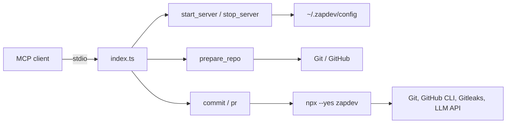

[](https://mvagnon.dev)
[](https://buymeacoffee.com/mvagnon)

# zapdev-mcp

> [!TIP]
> **Prefer the terminal?** Use **[zapdev](https://github.com/mvagnon/zapdev)**,
> the CLI powering this MCP server, for interactive commit and pull request workflows.

## Project Introduction

**zapdev-mcp** is a lightweight TypeScript MCP server that brings
[zapdev](https://github.com/mvagnon/zapdev) Git workflows to your AI assistant.

It prepares disposable GitHub checkouts, starts and stops development servers,
generates Conventional Commits, and creates pull requests through five tools
exposed over stdio. Commit and PR
commands run through `npx --yes zapdev`; no global zapdev installation is needed.

## Project Architecture



- `index.ts`: MCP server, input validation, repository management, and CLI calls.
- `repositories.ts`: shared repository paths and input validation.
- `config.ts`: shared repository and group configuration.
- `servers.ts`: server configuration, lifecycle commands, and startup context.
- `index.test.ts`: repository, server lifecycle, commit, and PR checks.
- `dist/index.js`: compiled executable included in the npm package.

## Environment Variables

| Variable          | Required            | Description                                                                  |
| ----------------- | ------------------- | ---------------------------------------------------------------------------- |
| `ZD_URL`          | For `commit` / `pr` | Complete HTTP(S) Chat Completions endpoint, including its path               |
| `ZD_MODEL`        | For `commit` / `pr` | Model identifier supported by the endpoint                                   |
| `ZD_EFFORT`       | For `commit` / `pr` | Reasoning effort supported by your model, such as `low`, `medium`, or `high` |
| `ZD_API_KEY`      | No                  | Bearer API key; omit for endpoints without authentication                    |
| `ZD_HOOK_TIMEOUT` | No                  | Deadline per Git hook in seconds; zapdev defaults to `60`                    |
| `ZD_REPOS_DIR`    | No                  | Absolute checkout root directory; defaults to `~/.zapdev/repos`              |

The `ZD_REPOS_DIR` variable configures this server; the others configure zapdev.
The model must support reasoning effort
and strict JSON Schema Structured Outputs; OpenAI compatibility or JSON mode alone
is not sufficient. See [zapdev model configuration](https://github.com/mvagnon/zapdev#model-configuration)
for local and OpenRouter examples.

## Setup

### Requirements

- **Node.js >= 20 and npm:** run the server and invoke zapdev through `npx`.
- **Git:** clones repositories and performs Git operations.
- **GitHub authentication:** configure non-interactive Git credentials for private
  repositories; install GitHub CLI and run `gh auth login` for `pr`.
- **LLM endpoint and model:** required for commit messages and PR titles.
- **Gitleaks (recommended):** zapdev scans staged changes when it is available on `PATH`.

### MCP Client Configuration

Once the package is published, add this server to a client supporting stdio MCP
servers. The following uses the common `mcpServers` format; adapt it to your client:

```json
{
  "mcpServers": {
    "zapdev": {
      "command": "npx",
      "args": ["--yes", "zapdev-mcp@latest"],
      "env": {
        "ZD_URL": "http://localhost:1234/v1/chat/completions",
        "ZD_MODEL": "your-local-model-id",
        "ZD_EFFORT": "low"
      }
    }
  }
}
```

Use your endpoint's complete Chat Completions URL and a model supporting strict
structured outputs. Add `ZD_API_KEY` if authentication is required. Keep credentials
private and do not commit them to your repository.

The MCP client must make `git`, `npx`, and, for PRs, `gh` available on the server's
`PATH`. The server runs on the client's host, not in an isolated sandbox.

## Usage

### `prepare_repo`

Clone or refresh a GitHub repository in `~/.zapdev/repos/<owner>-<repo>`.

Set `ZD_REPOS_DIR` to an absolute path to override the root directory. For example,
`ZD_REPOS_DIR=/srv/repos` places `owner/repo` in `/srv/repos/owner-repo`.
An unset or empty value uses the default. Use a full path, not a literal `~`.

With `group: "my-group"`, the checkout is placed in
`<ZD_REPOS_DIR>/my-group/owner-repo`. Existing `<owner>/<repo>` checkouts are not
moved or deleted.

| Argument | Required | Description                                                         |
| -------- | -------- | ------------------------------------------------------------------- |
| `repo`   | Yes      | GitHub repository as `owner/repo`                                   |
| `group`  | No       | Group folder under the repositories root; a single name, not a path |
| `branch` | No       | Remote branch to check out; defaults to the remote's default branch |

Returns only the absolute checkout `path`. Use `start_server` to retrieve
`AGENTS.md` instructions and configured URLs. This replaces `get_repo`;
clients using the old tool name must switch to `prepare_repo`.

After Git preparation and secret linking, runs the optional `prepareCommand` from
`zapdev.json`. The group's command takes priority and runs in the group directory;
otherwise the repository's command runs in its checkout. Waits for completion
(up to 180 seconds) before returning `path`. Command output is not included in
successful responses; command failures return an MCP error. Completed Git changes
and secret links are not rolled back. Without a command, nothing extra runs.

After each clone or refresh, matching secrets are symlinked from `~/.zapdev/secrets`:

| Source under `~/.zapdev/secrets/` | Destination under `ZD_REPOS_DIR`          |
| --------------------------------- | ----------------------------------------- |
| `my-group/config.json`            | `my-group/config.json`                    |
| `my-group/owner-repo/.env`        | `my-group/owner-repo/.env`                |
| `owner-repo/.env.local`           | `owner-repo/.env.local` (without `group`) |

Only files directly inside the group folder are linked into the group root.
The selected repository's secrets include subdirectories; other repositories are
not linked. Grouped checkouts do not inherit secrets from outside their group.
Missing secrets folders are ignored. Existing regular files (including old copies)
are replaced with absolute symlinks; links to the expected source are preserved.
Source symlinks, unrelated destination symlinks, and Git metadata are rejected.
Source permissions are unchanged: protect sensitive source files with `0600`.
Changes to the source are immediately visible through the link, and editing
through the link modifies the source secret. Keep repository symlinks ignored by
Git to prevent accidental commits; this tool does not add ignore rules.

**Destructive:** checkouts are disposable. Refreshing force-checks out the remote
branch, overwrites tracked changes, and removes untracked files and directories
except ignored files. Never use this tool for a checkout containing work you
want to keep. Git authentication must work without interactive prompts.

### Repository configuration: `zapdev.json`

Store configuration under `~/.zapdev/config`, following the same group/repository
layout as secrets. These files are read directly, not copied or symlinked into
checkouts. `ZD_REPOS_DIR` changes checkout locations, not configuration locations.

| Configuration path                                 | Applies to                |
| -------------------------------------------------- | ------------------------- |
| `~/.zapdev/config/owner-repo/zapdev.json`          | Standalone repository     |
| `~/.zapdev/config/my-group/zapdev.json`            | Group (parent)            |
| `~/.zapdev/config/my-group/owner-repo/zapdev.json` | Repository inside a group |

Copy this template to the applicable location and adapt the commands and URLs:

```json
{
  "prepareCommand": "docker compose pull",
  "startCommand": "docker compose up",
  "stopCommand": "docker compose down",
  "frontUrl": "http://localhost:3000",
  "apiUrl": "http://localhost:4000",
  "dbUrl": "postgresql://localhost:5432/app"
}
```

All six fields are optional; `{}` is valid. Missing files are treated as empty
configuration. Omitted commands do not run; omitted URLs are absent from context.
Commands must be nonempty strings; URLs must be valid absolute URLs, including
database schemes. Malformed files and source symlinks are rejected. Unknown fields
are ignored to allow future additions.

Commands execute through `/bin/sh` in the corresponding checkout or group directory
with the MCP server's environment. Only configure trusted commands: they run with
your host permissions. Replace the Docker Compose commands with a matching pair
for your project if needed. A start command may itself launch multiple services;
stop commands must handle their shutdown.

The parent takes priority **per field**:

- A group's `prepareCommand` replaces the selected child's prepare command and
  runs in the group directory, **once per `prepare_repo` call**, after that
  repository's Git preparation and secret linking. Other children might not yet
  be prepared. Without a parent command, the child's command runs in its checkout.
- A group's `startCommand` runs **once**, replacing all selected child start
  commands. Without it, each selected child's start command runs in its checkout.
- A group's `stopCommand` replaces the selected child's stop command and runs
  in the group directory. It may therefore stop the entire group.
- Each parent URL overrides the corresponding child URL. Other child URLs remain
  available. Grouped repositories do not inherit standalone configuration.
- Group `AGENTS.md` instructions take priority over repository instructions;
  both files are returned separately when starting a whole group.

### `start_server`

Start a prepared repository or group and return its context. Does not clone,
refresh, or reset repositories; call `prepare_repo` first for each repository.

| Argument | Required                   | Description                                                      |
| -------- | -------------------------- | ---------------------------------------------------------------- |
| `repo`   | Unless `group` is supplied | GitHub repository as `owner/repo`                                |
| `group`  | Unless `repo` is supplied  | Group name; combine with `repo` to select one grouped repository |

Examples: `{"repo":"owner/repo"}`, `{"group":"my-group"}`, or
`{"repo":"owner/repo","group":"my-group"}`.

Returns `path`, root `agents_md` when present, and configured `frontUrl`, `apiUrl`,
and `dbUrl`. A group also returns `repositories`, one entry per immediate child Git
checkout, with its path, root instructions, and effective URLs after parent
overrides. Other directories and symlinks are ignored. A single grouped repository
also includes a `parent` entry with the group's path, instructions, and URLs.

Configured commands run in the background with output discarded so development
servers do not block the MCP call or corrupt stdio. `commands` lists launch paths
and shell PIDs when commands were launched. This confirms process launch, **not
server readiness**; verify the relevant URL before using it. No automatic port
discovery, health checks, or duplicate-start protection is performed. Commands
can partially succeed before an error; do not retry blindly.

### `stop_server`

Run the configured stop command for a prepared repository.

| Argument | Required | Description                       |
| -------- | -------- | --------------------------------- |
| `repo`   | Yes      | GitHub repository as `owner/repo` |
| `group`  | No       | Group containing the repository   |

Waits for the command to finish (up to 180 seconds). Returns the repository `path`
and command `stdout` / `stderr`; without a command, returns only `path`. Processes
are not automatically killed using the startup PIDs. Configure `stopCommand` to
stop the services started by `startCommand`. Do not retry blindly after errors.

### `commit`

Commit changes in a local Git repository using zapdev without interactive review.

| Argument | Required | Description                                                                    |
| -------- | -------- | ------------------------------------------------------------------------------ |
| `path`   | Yes      | Absolute path inside the local Git repository                                  |
| `branch` | Yes      | Local branch to switch to or create before committing                          |
| `type`   | No       | Conventional Commit type; defaults to `auto`; append `!` for a breaking change |

Runs `zapdev commit --yes --pull --no-push --branch=<branch>`, adding `--type`
when a non-automatic type is supplied. Pulls fast-forward updates when an upstream
is configured, commits changes, and never pushes.

Supported types: `auto`, `feat`, `fix`, `deps`, `chore`, `docs`, `style`, `refactor`,
`perf`, `test`, `build`, `ci`, `revert`. Explicit types can include `!`, such as `feat!`.

**Privacy:** commit context is sent to the configured LLM endpoint. Gitleaks
scanning is skipped when it is not installed.

### `pr`

Push the current branch and create a GitHub pull request without confirmation.

| Argument | Required | Description                                                                   |
| -------- | -------- | ----------------------------------------------------------------------------- |
| `path`   | Yes      | Absolute path inside the local Git repository                                 |
| `branch` | No       | PR target branch, not the working branch; defaults to GitHub's default branch |
| `closes` | No       | HTTP(S) task URL to append as `Closes <url>` in the description               |

Runs `zapdev pr --yes` with the supplied target branch and task reference.
Requires a clean working tree and authenticated GitHub CLI. Full branch commit
messages are sent to the configured LLM to generate the title; the description
is built from the commits.

**Safety:** never force-pushes. Do not retry blindly after an error: the branch
may already have been pushed or the PR created. Task closure depends on the
linked provider's integration.
