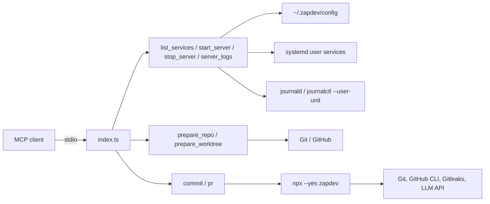

[](https://mvagnon.dev)
[](https://buymeacoffee.com/mvagnon)

# zapdev-mcp

> [!TIP]
> **Prefer the terminal?** Use **[zapdev](https://github.com/mvagnon/zapdev)** for interactive commits and pull requests.

## Project Introduction

**zapdev-mcp** brings [zapdev](https://github.com/mvagnon/zapdev) workflows to your AI assistant.
Eight stdio tools prepare disposable checkouts and worktrees, discover and manage services and logs, commit changes, and create pull requests.
Commit and PR tools use `npx --yes zapdev`.
No global installation is needed.

## Project Architecture



- `index.ts`: MCP server, input validation, repository management, and CLI calls.
- `repositories.ts`: shared repository paths and input validation.
- `preparation.ts`: shared secret linking and repository/group preparation.
- `worktrees.ts`: branch-named worktree creation and isolated preparation.
- `config.ts`: shared repository and group configuration.
- `servers.ts`: service selection and lifecycle tools.
- `service-manager.ts`: isolated systemd user units and bounded log access.
- `index.test.ts` / `servers.test.ts` / `worktrees.test.ts`: repository, worktree, service lifecycle, commit, and PR checks.
- `dist/index.js`: compiled executable included in the npm package.

## Environment Variables

| Variable          | Required            | Description                                                                  |
| ----------------- | ------------------- | ---------------------------------------------------------------------------- |
| `ZD_URL`          | For `commit` / `pr` | Complete HTTP(S) Chat Completions endpoint, including its path               |
| `ZD_MODEL`        | For `commit` / `pr` | Model identifier supported by the endpoint                                   |
| `ZD_EFFORT`       | For `commit` / `pr` | Reasoning effort supported by your model, such as `low`, `medium`, or `high` |
| `ZD_API_KEY`      | No                  | Bearer API key; omit for endpoints without authentication                    |
| `ZD_HOOK_TIMEOUT` | No                  | Deadline per Git hook in seconds; zapdev defaults to `60`                    |
| `ZD_REPOS_DIR`    | No                  | Absolute checkout root directory; defaults to `~/.zapdev/repos`              |

`ZD_REPOS_DIR` configures this server.
The other variables configure zapdev.
The model must support reasoning effort and strict JSON Schema Structured Outputs.
OpenAI compatibility or JSON mode alone is not enough.
See [zapdev model configuration](https://github.com/mvagnon/zapdev#model-configuration) for examples.

## Setup

### Requirements

- **Node.js >= 20 and npm:** run the server and invoke zapdev through `npx`.
- **Git:** clones repositories and performs Git operations.
- **Linux with a running systemd user manager:** required for service supervision.
  Services run without sudo in independent units.
- **`journalctl` from systemd 257+ and readable service journals:** required for `server_logs`.
  Queries are scoped to the current user's unit and UID.
- **GitHub authentication:** configure non-interactive Git credentials for private repositories.
  Install GitHub CLI and run `gh auth login` for `pr`.
- **LLM endpoint and model:** required for commit messages and PR titles.
- **Gitleaks (recommended):** zapdev scans staged changes when it is available on `PATH`.

### MCP Client Configuration

Add the server to a stdio MCP client.
Adapt this `mcpServers` example to your client:

```json
{
  "mcpServers": {
    "zapdev": {
      "command": "npx",
      "args": ["--yes", "zapdev-mcp"],
      "env": {
        "ZD_URL": "http://localhost:1234/v1/chat/completions",
        "ZD_MODEL": "your-local-model-id",
        "ZD_EFFORT": "low"
      }
    }
  }
}
```

Use the complete Chat Completions URL.
Choose a model with strict structured output support.
Set `ZD_API_KEY` when authentication is required.
Never commit credentials.

Make `git` and `npx` available on the server's `PATH`.
PR creation also requires `gh`.
The server runs on the client's host, not in a sandbox.

## Usage

### `prepare_repo`

Clone or refresh a GitHub repository in `~/.zapdev/repos/<owner>__<repo>`.

Set `ZD_REPOS_DIR` to an absolute path to change the checkout root.
For example, `ZD_REPOS_DIR=/srv/repos` places `owner/repo` in `/srv/repos/owner__repo`.
Unset or empty values use the default.
Use a full path, not a literal `~`.

With `group: "my-group"`, the checkout lives in `<ZD_REPOS_DIR>/my-group/owner__repo`.
Other checkouts are not moved or deleted.
Rename existing `owner$repo` or `owner-repo` checkout, secret, and configuration folders to `owner__repo` to reuse them; no automatic migration or legacy-name fallback is performed.
Stop services before renaming checkouts; update hard-coded paths and recreate secret symlinks whose targets changed before preparing again.

| Argument | Required | Description                                                               |
| -------- | -------- | ------------------------------------------------------------------------- |
| `repo`   | Yes      | GitHub repository as `owner/repo`; without `group`, selects the root checkout |
| `group`  | No       | Single group name containing the selected checkout                        |
| `branch` | No       | Remote branch; defaults to the remote's default branch                     |

Supply a nonempty `repo`, optionally with `group`.
An empty `group` counts as omitted.
Calls with `group` alone or an empty `repo` are rejected.

Returns the absolute checkout `path`.
Only the selected checkout is prepared.

After Git preparation and secret linking, runs the optional `prepareCommand` from `zapdev.json`.
With `group`, an existing group configuration takes precedence over the checkout configuration; its command runs in the group directory.
Only when the group configuration file is absent does the checkout's command run, in the checkout directory.
Grouped checkouts link both group-root and selected repository secrets before running the selected command.
Each command has a 180-second timeout.
Preparation stops at the first failure.
Completed Git changes and secret links are not rolled back.
Successful responses omit command output.
Command failures return an MCP error.

After each clone or refresh, matching secrets are symlinked from `~/.zapdev/secrets`:

| Source under `~/.zapdev/secrets/` | Destination under `ZD_REPOS_DIR`          |
| --------------------------------- | ----------------------------------------- |
| `my-group/config.json`            | `my-group/config.json`                    |
| `my-group/owner__repo/.env`        | `my-group/owner__repo/.env`                |
| `owner__repo/.env.local`           | `owner__repo/.env.local` (without `group`) |

With `repo + group`, both group-root files and repository secrets are linked before the selected prepare command.
Group-root secrets stay in the group directory, never in child checkouts.
Only the selected checkout's secrets are linked recursively.
Other repos' secrets are untouched.
Grouped checkouts do not inherit secrets from outside their group.
Missing secrets folders are ignored.
Existing regular files are replaced with absolute symlinks.
Matching symlinks are reused.
Source symlinks, unrelated destination symlinks, and Git metadata are rejected.
Protect sensitive source files with `0600`.
Source permissions are unchanged.
Editing a symlink changes the source secret.
Keep secret symlinks Git-ignored.
This tool does not add ignore rules.

**Destructive:** checkouts are disposable.
Call this tool only when the user explicitly requests preparing or resetting the selected checkout, never automatically as a prerequisite for another task.
Refresh overwrites tracked changes and removes untracked files and directories.
Ignored files are preserved.
Never prepare a checkout containing work you want to keep.
Git authentication must work without prompts.

### `prepare_worktree`

Prepare new branches and linked worktrees from the selected local repositories' current `HEAD`s, then link their secrets and run preparation commands.
A repository or subdirectory path selects only its enclosing repository, even inside a group.
Outside a repository, a group path selects its immediate child repositories and worktrees; hidden directories, symlinks, and `node_modules` are excluded.
An empty selection is rejected.
Source branches and uncommitted changes are left untouched; only committed files enter the new worktrees.
This tool does not clone, fetch, reset, or clean source repositories.

| Argument | Required | Description |
| -------- | -------- | ----------- |
| `path` | Yes | Absolute source repository, worktree, subdirectory, or group path; no `~` |
| `branch` | Yes | New branch in every selected repository and workspace name; must not already exist |

Example: `{"path":"/srv/repos/my-group","branch":"feat/search"}`.
No `repo` or `group` arguments are accepted; selection and secret identity are derived from `path`.
Returns every created repository path and an explicit instruction to work there, not in the source repositories:

```json
{
  "paths": [
    "/home/user/.zapdev/worktrees/feat/search/owner__frontend",
    "/home/user/.zapdev/worktrees/feat/search/owner__backend"
  ],
  "instructions": "Work exclusively in the returned worktree paths. Do not modify the source repositories."
}
```

| Source | New repository path |
| ------ | ------------------- |
| Standalone repository | `~/.zapdev/worktrees/<branch>` |
| Group or single grouped checkout | `~/.zapdev/worktrees/<branch>/owner__repo`, for each selected repository |

Slashes in branch names create nested directories.
Workspace names are shared across repositories; existing paths, branches, symlinked destination directories, and nesting inside an existing worktree are rejected.
All selected repositories' branches, HEADs, and destination-name collisions are checked before creating any worktree.
Creation uses `git worktree add -b <branch> <path> <source-HEAD>` without force, with the same branch name in each repository.

Secret and configuration selection follows the main checkout's layout under `ZD_REPOS_DIR`, even when the source is another linked worktree.
For repositories outside that root, a GitHub `origin` maps to `owner__repo`; otherwise, the main checkout's directory name is used.
External repository paths use standalone secrets and configuration; external group paths use the selected group's directory name.
Secrets remain symlinks to shared source files, not independent copies; keep them Git-ignored.

Secret linking is shared with `prepare_repo`, including group-root files and recursive repository secrets.
All selected worktrees are created and receive their secrets before any preparation command runs.
Grouped sources get an isolated workspace root containing group-root secrets and all selected repositories.
Group configuration takes precedence, and its `prepareCommand` runs once in that workspace root.
When the group configuration is absent, each repository's command runs inside its own worktree.
Selecting one grouped repository still prepares only that repository, so a group command requiring siblings may fail.
Commands retain the 180-second timeout and run with the MCP server's host permissions.

Failures are returned as MCP errors with the completed worktrees' `paths`; created directories, branches, and partial preparation are retained for inspection, not reset or rolled back.
Do not blindly retry a failed creation.
PR cleanup removes the linked Git worktree, but a grouped workspace's outer directory and group-root files remain.
Service tools still select prepared checkouts under `ZD_REPOS_DIR`; this tool does not extend their selection to worktrees.

### Repository configuration: `zapdev.json`

Store configuration under `~/.zapdev/config`, using the same layout as secrets.
Configuration files are read directly.
They are not copied or symlinked into checkouts.
`ZD_REPOS_DIR` changes checkout locations, not configuration locations.

| Configuration path                                 | Applies to                |
| -------------------------------------------------- | ------------------------- |
| `~/.zapdev/config/owner__repo/zapdev.json`          | Standalone repository     |
| `~/.zapdev/config/my-group/zapdev.json`            | Group (parent)            |
| `~/.zapdev/config/my-group/owner__repo/zapdev.json` | Repository inside a group |

Copy this template to the applicable location and adapt the commands and URLs:

```json
{
  "prepareCommand": "docker compose pull",
  "services": {
    "frontend": { "startCommand": "npm run dev" },
    "backend": {
      "startCommand": "docker compose up",
      "stopCommand": "docker compose down"
    }
  },
  "frontUrl": "http://localhost:3000",
  "apiUrl": "http://localhost:4000",
  "dbUrl": "postgresql://localhost:5432/app"
}
```

All fields are optional.
An existing configuration file takes precedence even when it contains `{}` or lacks the relevant command or services.
Only a missing group configuration file enables fallback to checkout configurations; configurations are not merged.
Omitted commands do not run.
URLs are metadata and are not returned by service tools.
They must be absolute URLs, including database schemes.
Malformed files, unknown fields, and source symlinks are rejected.

| Field                          | Meaning                                                                         |
| ------------------------------ | ------------------------------------------------------------------------------- |
| `prepareCommand`               | Optional nonempty shell command executed by `prepare_repo` and `prepare_worktree` |
| `services`                     | Optional object of named services for this checkout or group; `{}` defines none |
| `services.<name>.startCommand` | Required nonempty shell command for that service                                |
| `services.<name>.stopCommand`  | Optional nonempty shell command executed after the service's processes stop     |
| `frontUrl`, `apiUrl`, `dbUrl`  | Optional URL metadata; omitted from tool responses                              |

Service names contain 1–63 ASCII letters, digits, `_`, or `-`.
They must begin with a letter or digit.
Unit IDs hash the checkout/group path and service name to avoid collisions.

Commands run through `/bin/sh` in their checkout or group directory.
They inherit the MCP server's environment, except systemd invocation variables.
Only configure trusted commands.
They run with your host permissions.
Run development servers in the foreground, without `&`.
Do not hide nonzero exit codes behind wrappers.
Otherwise systemd supervises the wrapper, not the server.

`stopCommand` uses `ExecStopPost`.
Systemd can also run it after startup or runtime failures.
Cleanup must tolerate partial startup and repeated execution.

Commands and services are scoped to the selection:

- Service tools default to the MCP server's working directory.
- A checkout path selects only that repo.
- A group path selects only the group's services when its configuration file exists.
- Without a group configuration file, a group path selects its immediate child checkouts' services.
- A group configuration with `{}`, `services: {}`, or no `services` selects no services; it does not fall back to children.
- The service-name filter applies across all selected paths, including duplicate names.
- `prepare_repo` with `repo` alone selects a root checkout.
- `prepare_repo` with `repo` and `group` prepares one checkout, then uses the group configuration if present, otherwise that checkout's configuration.
- `prepare_repo` requires `repo`; `group` alone is rejected.
- Explicit checkout paths for service tools never select group services.
- All service tools use the same configuration selection.

Before adopting a group configuration, stop any previously started child services using their explicit checkout paths.

### `list_services`

List configured services without starting them, running commands, or querying systemd.
Accepts the same optional `path` (default server cwd) and `service` as `start_server`.
Returns `{ path, services: [{ name, path }] }`; commands, URLs, logs, and runtime states are omitted.
An empty selection returns `services: []`; an unknown service filter returns an error.
This read-only tool does not require Linux or systemd and does not check readiness.

### `start_server`

Start a prepared repository or group and return compact service states.
No Git operations are performed.
Call `prepare_repo` first.

| Argument  | Required | Description                                                                                                                       |
| --------- | -------- | --------------------------------------------------------------------------------------------------------------------------------- |
| `path`    | No       | Absolute path inside a prepared checkout, a group directory, or `ZD_REPOS_DIR` itself; defaults to the server's working directory |
| `service` | No       | Configured service name; otherwise selects all services                                                                           |

With `ZD_REPOS_DIR=/srv/repos`:

- `{}` uses the server's current directory.
- `{"path":"/srv/repos/my-group/owner__repo"}` selects one checkout.
- `{"path":"/srv/repos/my-group"}` selects the whole group.

A subdirectory inside a checkout resolves to its root.
Selecting `ZD_REPOS_DIR` itself uses its configuration if present, otherwise its immediate checkouts.
Nested groups are not traversed.

**The default cwd belongs to the server process, not your MCP client's active folder.**
Paths must remain inside `ZD_REPOS_DIR`.
Outside paths and symlinked directories are rejected.
When using `npm run inspect` from this source repository, supply `path` explicitly.
Omitted and empty `path` values both use the server cwd.
Service tools accept `path`, not `repo` or `group`.

Returns only `path` and `services`.
Each service contains `name`, `path`, observed `state`, and an optional `error`.
Instructions, URLs, unit IDs, exit codes, and logs are omitted.
Use `server_logs` for diagnostics.
Read project instructions from disk.

Each service uses a transient systemd user unit.
Active units are reused across MCP restarts.
Stop failed units before restarting them.
Command and environment changes apply on the next fresh start.
Units are not configured to restart automatically or survive a machine reboot.
Remaining logged in is normally required.
Enable user lingering separately to keep services after logout.

New starts are observed for about one second to detect immediate failures.
Launch errors are preserved without automatically reading logs.
**An active process is not a readiness guarantee.**
Later crashes appear in `server_logs`.
Successful commands can remain `active` after exiting.
`server_logs` reports `subState: exited` for these units.
Use a `stopCommand` for externally managed services such as `docker compose up -d`.

Partial successes remain in the response.
Any service error marks the overall MCP response as an error.
No automatic port discovery or health checks are performed.

### `stop_server`

Accepts the same optional `path` (default server cwd) and `service` as `start_server`.
Sends SIGINT to all processes in the unit.
After 30 seconds, remaining processes receive SIGKILL.
The optional `stopCommand` then runs with its own 30-second timeout.
Verifies that systemd reports no main process, control process, or remaining tasks before releasing the unit.
Missing process-accounting information fails verification when a control group still exists.
An old `failed` state is cleared with a unit-scoped `reset-failed`, allowing a fresh start.
Waits up to two additional seconds for the transient unit to unload; a retained unit is an error, not a successful stop.
Absent units are unchanged.
Unrelated systemd units cannot be selected.
Verification covers the selected systemd units; detached external services still require a working `stopCommand`.

Returns the same compact summary as `start_server`.
Failed cleanup is reported even if the application has stopped.
Cleanup failures remain errors even when the unit has been released successfully.
No logs are read and no Git changes are made.
Use `server_logs` for details.

Example: `{"path":"/srv/repos/my-group","service":"backend"}`.

### `server_logs`

Reads stdout/stderr and systemd diagnostics directly from journald.
Queries use `--user-unit` to filter by unit and UID.
Only the latest invocation recorded in the journal is shown, using `--invocation=0`.
Timestamps include the date, time, microseconds, and timezone offset.
Logs can be stored in the system journal or a separate user journal.
The MCP does not maintain log files.
Retention and rotation follow the host's journal settings.
Logs remain readable after service stops and MCP restarts until journal retention removes them.

| Argument  | Required | Description                                                        |
| --------- | -------- | ------------------------------------------------------------------ |
| `path`    | No       | Same checkout/group scope as startup; defaults to the server cwd   |
| `service` | No       | Select a configured name; otherwise returns every selected service |
| `lines`   | No       | Last lines per service; defaults to 100, maximum 1000              |

Returns service identity, unit `id`, state, result, `exitCode`, `logs`, and `truncated`.
Systemd process diagnostics (`mainPid`, `controlPid`, `tasks`, and `controlGroup`) are included when available.
Failed services remain marked as errors alongside their logs.
Responses contain at most the last 64 KiB per service.
ANSI control sequences are removed.
No logs are streamed to the MCP client.
An empty result means no entries were found.
Nonzero `journalctl` exits report reading errors.
Nonfatal warnings do not fail a successful query.
Logs may contain application secrets; do not share them without review.

Example: `{"path":"/srv/repos/my-group/owner__repo","service":"frontend","lines":50}`.

### `commit`

Commit changes in the enclosing local Git repository, or a group's immediate child repositories, using zapdev without interactive review.

| Argument | Required | Description                                                                    |
| -------- | -------- | ------------------------------------------------------------------------------ |
| `path`   | Yes      | Absolute repository, worktree, subdirectory, or group path                     |
| `branch` | No       | Local branch to switch to or create; defaults to the current branch            |
| `type`   | No       | Conventional Commit type; defaults to `auto`; append `!` for a breaking change |
| `pull`   | No       | Boolean; pull fast-forward updates before committing; defaults to `false`     |
| `push`   | No       | Boolean; push after committing without confirmation; defaults to `false`     |

Runs:

```bash
zapdev commit <path> --yes --no-push
```

Optional arguments add `--branch=<branch>` and `--type=<type>`.
Setting `pull: true` adds `--pull` to pull fast-forward updates when an upstream exists.
Setting `push: true` replaces `--no-push` with `--push` to push after committing.
Without `branch`, commits on the current branch.
Does not pull or push by default.
The path is passed directly to zapdev without changing the MCP server's working directory; linked worktree paths are supported.

Supported types: `auto`, `feat`, `fix`, `deps`, `chore`, `docs`, `style`, `refactor`, `perf`, `test`, `build`, `ci`, `revert`.
Append `!` for breaking changes, such as `feat!`.

**Privacy:** commit context is sent to the configured LLM endpoint.
Gitleaks scanning is skipped when it is not installed.

### `pr`

Push the current branch and create a GitHub pull request without confirmation for the enclosing repository or a group's immediate child repositories.

| Argument | Required | Description                                                                   |
| -------- | -------- | ----------------------------------------------------------------------------- |
| `path`   | Yes      | Absolute repository, worktree, subdirectory, or group path                    |
| `branch` | No       | PR target branch, not the working branch; defaults to GitHub's default branch |
| `closes` | No       | HTTP(S) task URL to append as `Closes <url>` in the description               |

Runs `zapdev pr <path> --yes --cleanup-worktrees --json` with the supplied target branch and task reference, without changing the MCP server's working directory.
The CLI's JSON result is returned in `stdout`, including PR URLs and deleted/skipped worktree paths; diagnostics remain in `stderr`.
Requires a clean working tree and authenticated GitHub CLI.
Full branch commit messages are sent to the configured LLM to generate the title.
The description is built from the commits.

The MCP server must run outside every targeted linked worktree, including subdirectories and symlinked paths; otherwise, the CLI refuses before pushing.
After successful PR creation, cleanup removes matching linked worktree directories and Git registrations, **including ignored files**.
The main worktree, branches and commits are preserved. Locked, missing, dirty or branch/HEAD-changed worktrees are skipped with warnings; removal is never forced.

**Safety:** never force-pushes.
Check remote state before retrying an error.
The branch may already be pushed or the PR created.
Task closure depends on the linked provider's integration.
